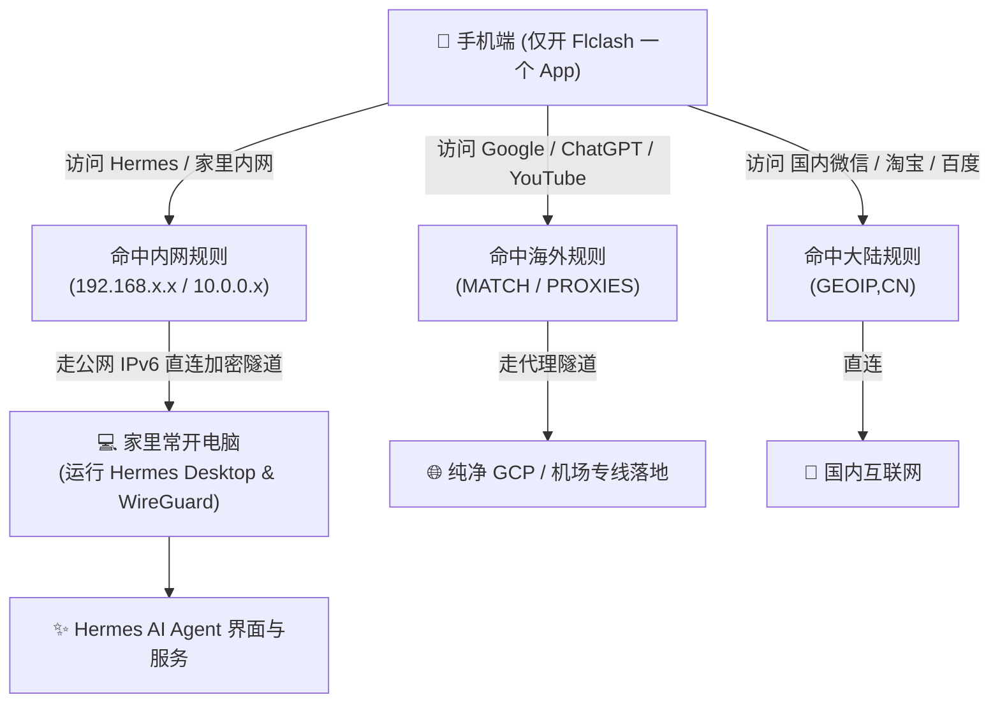

# 🚀 Hermes App 手机远程直连实战指南（方案 C：IPv6 + WireGuard + Flclash 单 App 并存流）

> **方案定位**：**方案 C（独立完整版）** —— 手机端仅运行一个 **Flclash**，无需安装 Tailscale，借助家庭 **公网 IPv6** 与 **WireGuard**，实现「外出随时访问家里电脑上的 Hermes AI Agent」与「极速外网代理」完美并存。
> *(注：本方案与“姿势二：Tailscale 出口节点流”完全独立拆分)*

---

## 🏗️ 架构与分流原理

安卓系统底层强制限制只能激活一个 VPN。方案 C 的核心思想是**将 WireGuard 内嵌在 Clash/Mihomo 的配置中**，由 Flclash 统一管理分流：



---

## 🛠️ 第一步：家里电脑与路由器的 IPv6 环境配置

因为原生 WireGuard 属于纯点对点协议，没有第三方打洞服务器，因此**必须依靠公网 IPv6 作为入口**：

### 1. 检查电脑是否具备公网 IPv6
在电脑 PowerShell 运行以下命令：
```powershell
# 查看本机分配的 IPv6 地址（国内三大运营商公网通常以 2408 / 2409 / 240e 开头）
Get-NetIPAddress -AddressFamily IPv6 | Where-Object { $_.PrefixOrigin -eq "RouterAdvertisement" -or $_.PrefixOrigin -eq "Dhcp" } | Select-Object IPAddress
```
* 如果能看到 `2409:...` 或 `2408:...`，说明你的电脑已具备公网 IPv6！

### 2. 路由器 / 光猫 IPv6 防火墙放行
* 登录家庭路由器后台（如 `192.168.1.1`）；
* 确保已开启 **IPv6**（推荐选择 Native 原生模式）；
* 在路由器安全/防火墙设置中，找到 **IPv6 防火墙**：
  * 放行电脑的入站 UDP 端口：**`51820`**。

### 3. 配置 IPv6 动态域名（DDNS）
家庭宽带的 IPv6 会定期变动（几天重新拨号一次），需要绑定一个固定域名：
* 使用 Cloudflare、腾讯云、阿里云等服务商；
* 运行轻量 DDNS 脚本，为域名添加 **AAAA 记录**（例如解析到 `hermes.yourdomain.com`）。

---

## ⚙️ 第二步：电脑端部署 WireGuard 服务端（Windows）

1. 安装官方 Windows 版 WireGuard；
2. 生成两对公私钥：
   * **电脑服务端**：`ServerPrivateKey` / `ServerPublicKey`
   * **手机客户端**：`ClientPrivateKey` / `ClientPublicKey`
3. 创建服务端配置文件 `wg0.conf`：
   ```ini
   [Interface]
   PrivateKey = <ServerPrivateKey>
   ListenPort = 51820
   Address = 10.0.0.1/24

   [Peer]
   PublicKey = <ClientPublicKey>
   AllowedIPs = 10.0.0.2/32
   ```
4. 开启 Windows 内核路由转发：
   * 注册表：`HKEY_LOCAL_MACHINE\SYSTEM\CurrentControlSet\Services\Tcpip\Parameters`，将 `IPEnableRouter` 设为 `1`；
   * Windows 防火墙：高级设置中新建入站规则，放行 UDP 端口 `51820`。

---

## 📱 第三步：手机 Flclash 的 YAML 配置文件集成（核心）

把家里基于 IPv6 的 WireGuard 节点直接写入到手机使用的 `.yaml` 配置文件中：

### 1. 节点定义（在 `proxies:` 列表中加入）
```yaml
proxies:
  # === 家里电脑的 WireGuard IPv6 直连节点 ===
  - name: "🏡 Hermes-家里直连"
    type: wireguard
    server: hermes.yourdomain.com      # 你的 IPv6 DDNS 域名（或直接填 IPv6 地址如 [2409:8a1e:...]:51820）
    port: 51820                        # WireGuard 端口
    ip: 10.0.0.2                       # 手机在 WireGuard 虚拟网段中的 IP
    public-key: <电脑服务端的公钥>      # 服务端公钥
    private-key: <手机客户端的私钥>     # 手机私钥
    udp: true
    remote-dns-resolve: false
    dns: [192.168.1.1, 223.5.5.5]
```

### 2. 分流规则定义（在 `rules:` 列表中最顶部插入）
```yaml
rules:
  # 1. 访问家里内网设备与 Hermes 服务走 IPv6 WireGuard 隧道
  - IP-CIDR,192.168.0.0/16,🏡 Hermes-家里直连,no-resolve
  - IP-CIDR,10.0.0.0/24,🏡 Hermes-家里直连,no-resolve

  # 2. 国内常见应用直连
  - GEOIP,CN,DIRECT

  # 3. 兜底所有海外流量走外网代理组（如 GCP 链式代理）
  - MATCH,PROXIES
```

---

## 🤖 附：让其他 AI 帮配置的专属 Prompt（一键复制）

可以直接将以下提示词发送给 ChatGPT / Claude / Cursor：

```markdown
# 任务目标：配置基于公网 IPv6 的 WireGuard 节点并内嵌至 Clash/Mihomo (Flclash) YAML 文件

## 背景与需求
用户希望在手机端仅运行一个 Flclash（Mihomo 内核）应用，不安装 Tailscale，同时实现：
1. 借助家庭宽带的公网 IPv6，直连家里运行的 Hermes Agent 及局域网内网；
2. 海外网站继续走现有代理策略组（GCP / 机场落地）；
3. 解决安卓单 VPN 冲突。

## 请按以下步骤执行：
1. 检查并指导用户获取本地电脑的公网 IPv6 地址（2408/2409/240e 开头），并确认已在路由器放行 UDP 51820 端口；
2. 生成 WireGuard 的公私钥对，输出本地服务端的 wg0.conf 模板；
3. 读取用户现有的 Clash YAML 配置文件，在 proxies 列表中新增支持 IPv6 的 type: wireguard 节点（包含 server、port、ip、public-key、private-key）；
4. 在 rules 列表最顶部插入局域网 CIDR 分流规则（指向该 WireGuard 节点），确保内网流量走 IPv6 直连隧道，海外流量走 MATCH,PROXIES；
5. 输出严格采用 UTF-8（无 BOM）编码的修改后完整 YAML 配置。
```

---

## 📄 License
MIT © 2026. 欢迎自由 Fork 与交流！
