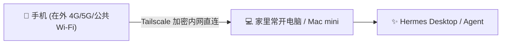

# 🚀 Hermes Agent / Desktop 手机远程连接实战指南

> **免公网 IPv4 / 免公网 IPv6 / 免路由器端口映射**  
> 随时随地在外用手机（4G/5G/外部Wi-Fi）直连家里电脑上常开的 **Hermes AI Agent**！

---

## 💡 为什么传统的内网穿透方案行不通？

很多教程推荐使用原生 WireGuard、DDNS 或端口映射连回家里的 AI 应用，但在实际生活中，这些方案对普通人极其不友好：
1. **必须强依赖公网 IPv6**：国内大部分家庭宽带都在大内网中，没有公网 IPv4；如果走原生 WireGuard，必须要求家里和手机全天候支持公网 IPv6。
2. **外部网络经常没有 IPv6**：在外面的公司、酒店、商场公共 Wi-Fi，很多只有纯 IPv4，导致 IPv6 穿透直接瘫痪。
3. **路由器配置复杂**：需要折腾光猫桥接、关闭 IPv6 防火墙、配置 DDNS 脚本，极其繁琐。

---

## 🌟 终极无缝方案：Tailscale 点对点直连 Hermes

通过 Tailscale 的虚拟内网网络，完全**不需要公网 IP，也不需要修改路由器**，两端自动穿透握手：



---

## 🛠️ 第一步：家里电脑端设置（运行 Hermes）

### 1. 启动 Hermes Agent / Desktop
* 在电脑上正常启动 **Hermes Desktop** 应用或后台 Gateway 服务；
* Hermes 会在本地监听对应端口（如 Web 界面默认端口或 Gateway 端口）。

### 2. 电脑安装并登录 Tailscale
1. 下载并安装官方客户端：[Tailscale 官网下载](https://tailscale.com/download)；
2. 登录您的账号（支持 Google / Apple / GitHub 登录）；
3. 记录当前电脑在 Tailscale 网络中的 **100.x.x.x 专用内网 IP**（例如 `100.113.228.56`）。

---

## 📱 第二步：手机端连接（在外随时使用）

1. 在手机上下载并安装 **Tailscale App**；
2. 登录与电脑**完全相同的账号**；
3. 打开连接开关（Connected）；
4. 打开手机浏览器，直接访问：
   ```text
   http://<你电脑的Tailscale内网IP>:<Hermes端口>
   ```
   * 例如：`http://100.113.228.56:8000`

👉 **无需配置任何端口映射，无需考虑 IPv6，直接像在本地一样流畅与家里的 Hermes 智能体对话！**

---

## ⚡ 常见问题与进阶技巧

### Q1：手机开 4G/5G 流量连接慢怎么办？
* 检查家里路由器是否开启了 **UPnP**；
* 开启 UPnP 后，手机与家里电脑能直接建立 P2P 直连（Direct Connection），延迟通常低于 30ms。

### Q2：电脑可以同时作为出海代理跳板吗？
* 可以！在电脑端 Tailscale 右键开启 `Run exit node`，在手机端将 Exit Node 选择为这台电脑，手机在外还能顺带借用家里的网络环境。

---

## 📄 License
MIT © 2026. 欢迎自由 Fork 与分享！
